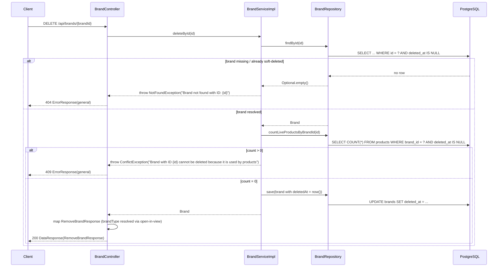

## Context

The `Brand` aggregate already carries full soft-delete machinery: `brands.deleted_at` exists (Flyway `V0.1.0__initialData_SM.sql`), and the entity is annotated `@SQLDelete` + `@SQLRestriction("deleted_at IS NULL")` (`domain/models/brand/Brand.java`), so every JPA read already excludes soft-deleted rows. What is missing is the write path: no `DELETE` route exists on `BrandApi`. See `proposal.md` (Why) for motivation and `specs/brands-management/spec.md` for the normative behavior contract — this document does not restate them.

The implementation mirrors an existing, in-production precedent end to end: `DELETE /api/dispensaries/{id}` spans `DispensaryApi.delete` (`@DeleteMapping("/{id}")`, `@ResponseStatus(OK)`, `DataResponse<RemoveDispensaryResponse>`), `DispensaryController.delete` (thin delegation + response mapping) and `DispensaryServiceImpl.deleteById` (resolve → mark → save inside `@Transactional`). The error pipeline is already in place and needs no changes: `GlobalExceptionHandler` maps `NotFoundException` → `404`, `ConflictException` → `409`, and `MethodArgumentTypeMismatchException` → `400`, all through the standard `ErrorResponse` envelope.

Referential landscape around `brands` (verified against the Flyway schema):

| Table | Reference | Soft-delete aware | Guarded by this change |
|---|---|---|---|
| `products` | `brand_id` NOT NULL FK | yes (`deleted_at`) | **yes** |
| `brand_images` | `brand_id` NOT NULL FK | yes (`deleted_at` + `status`, `V0.1.1`) | no (Decision 7) |
| `brand_featured_products` | `brand_id`, junction | no | no (Decision 7) |
| `fav_user_brands` | `brand_id`, junction | no | no (Decision 7) |

`spring.jpa.open-in-view: true` is set in `src/main/resources/application.yml`; the delete-and-map path is load-bearing on it (Risk 11).

## Goals / Non-Goals

**Goals:**

- Expose `DELETE /api/brands/{brandId}` following the dispensary delete precedent exactly (same layering, same envelope, same transaction shape), so the codebase keeps one soft-delete idiom.
- Make the four items left open by the specs phase unambiguous for the tasks phase: success payload shape, exact error message strings, native-query guard semantics, and the `409` (not `400`) status decision.
- Decide and state the guarding scope for `brand_images` / `brand_featured_products` / `fav_user_brands`.
- Keep the `Brand` aggregate boundary intact: no inverse `products` collection, no `Product` entity loaded into the brand delete flow.

**Non-Goals:**

- No physical delete, no hard-delete escape hatch, no `204 No Content` variant (standards defer it).
- No cascading soft delete of the brand's images, videos, featured-product entries or user favorites.
- No purge/reconciliation job for dangling junction rows (documented as a trade-off, not built).
- No changes to `GlobalExceptionHandler`, `DataResponse`, `ErrorResponse`, or any existing route — the change is purely additive.
- No database migration: `brands.deleted_at` already exists; nothing to add.

## Decisions

### Decision 1: Success payload — new `RemoveBrandResponse` record mirroring the dispensary precedent

`DELETE /api/brands/{brandId}` returns `200 OK` with `DataResponse<RemoveBrandResponse>` where:

```java
public record RemoveBrandResponse(
    Long id,
    String name,
    String description,
    String stateLicense,
    String brandType,   // Brand.brandType.getName(), resolved post-commit (Risk 11)
    Integer adminId) {}
```

This mirrors `RemoveDispensaryResponse` (identity + core business fields + the parent's lookup-state field + `adminId`) rather than the fuller `GetBrandResponse`: a removal confirmation is a distinct, smaller contract than a read model, and the dispensary precedent deliberately made that split.

- **Rationale**: one predictable delete idiom across the API; clients get enough of the deleted entity to confirm what was removed.
- **Alternatives considered**: (a) reuse `GetBrandResponse` — rejected: couples the removal contract to the read model and forces mapping social-media URLs nobody needs on a tombstone; (b) `204 No Content` — rejected: `docs/backend-standards.md:423` explicitly defers it and the precedent returns `200` + body.

### Decision 2: Orchestration order and transaction — resolve, guard, mark, inside one service transaction

`BrandService.deleteById(Long id)` (new method, implemented in `BrandServiceImpl`, annotated `@Transactional(rollbackFor = Exception.class, propagation = Propagation.REQUIRED)` like the existing write methods) executes, in order:

1. **Resolve**: `brandRepository.findById(id)` → empty → throw `NotFoundException`. Because of `@SQLRestriction("deleted_at IS NULL")`, an already-soft-deleted brand is invisible to `findById`, so the "already deleted → 404" scenario falls out of the same lookup — no manual `deletedAt` filter is added.
2. **Guard**: `countLiveProductsByBrandId(id) > 0` → throw `ConflictException` (Decision 4).
3. **Mark**: `brand.setDeletedAt(LocalDateTime.now())` then `brandRepository.save(brand)`; return the brand so the controller can map the response.

The ordering hard-codes the spec's "404 takes priority over 409" rule structurally: the guard cannot even run for a missing or already-deleted brand.

- **Rationale**: identical shape to `DispensaryServiceImpl.deleteById` (minus its redundant `deletedAt` filter, which is dead code there because `Dispensary` also carries `@SQLRestriction`); atomicity is free — the only mutation happens last, and `rollbackFor = Exception.class` covers any future mutation added before the guard.
- **Alternatives considered**: (a) replicate the dispensary's manual `.filter(d -> d.getDeletedAt() == null)` — rejected: redundant with `@SQLRestriction` and misleading (implies `findById` can return deleted rows); (b) put the guard in the controller — rejected: business invariants belong to the application layer (SRP), and the controller stays a thin mapper.

### Decision 3: Exact error message strings (deterministic for tests)

| Case | Status | `ErrorResponse` entry | Exact message |
|---|---|---|---|
| Brand missing or already soft-deleted | `404` | field `general` | `Brand not found with ID: {id}` |
| Brand referenced by ≥ 1 non-deleted product | `409` | field `general` | `Brand with ID {id} cannot be deleted because it is used by products` |
| Non-numeric `{brandId}` | `400` | field `id` | `Invalid value for parameter: id` (existing `MethodArgumentTypeMismatchException` handler, unchanged) |

The `404` string matches the existing `BrandController.getById` convention (`"Brand not found with ID: " + id`), so both brand lookups fail with the same wording. The `409` string instantiates the `"… cannot be deleted because it is used by products"` wording required by `docs/backend-standards.md:423` and the spec scenario. The `400` row involves no new code — it documents the existing handler output so tests can assert it.

- **Rationale**: integration and unit tests assert exact strings; leaving these to implementation whim is what made the specs phase defer them here.
- **Alternatives considered**: templated/i18n message keys — rejected: the project has no message-catalog infrastructure and the standards treat these strings as de-facto API contract.

### Decision 4: Referential-integrity guard — native count query on `BrandRepository`

```java
@Query(
    value = "SELECT COUNT(*) FROM products p WHERE p.brand_id = :brandId AND p.deleted_at IS NULL",
    nativeQuery = true)
long countLiveProductsByBrandId(@Param("brandId") Long brandId);
```

Semantics: count **only** rows in `products` whose `brand_id` equals the brand and whose `deleted_at IS NULL`. Soft-deleted products do not count, so a brand referenced exclusively by deleted products is deletable (spec scenario "referenced only by soft-deleted products"). The guard is `count > 0 → ConflictException`; no product entities are loaded, no `Product` repository is injected into the brand flow.

- **Rationale**: `docs/backend-standards.md:423` prescribes exactly this seam — "Cross-aggregate checks use a native query as an anti-corruption seam". It keeps the check inside the `Brand` bounded context (DDD: the brand context asks a question about its own referential safety without importing the `Product` aggregate), costs one indexed-ish count instead of an entity load, and honors the proposal's constraint that no inverse `products` collection is added to `Brand`.
- **Alternatives considered**: (a) JPQL across a mapped association — rejected: would require mapping `Brand.products` (inverse collection) that the proposal explicitly forbids; (b) inject `ProductRepository` into `BrandServiceImpl` — rejected: couples two aggregate roots' services for one count (SRP/DIP smell) and drags product hydration into a brand flow; (c) database trigger/FK enforcement — rejected: soft delete never violates a physical FK, so the database cannot express "no *live* product references this brand"; the rule is business state, which is the application layer's job.

### Decision 5: `409 Conflict` confirmed for brand-in-use

Confirmed per `docs/backend-standards.md:423`: `400` is reserved for malformed input; business-state conflicts get `409`. The source ticket's "bad request" wording is superseded — this was already captured as a traceability note in the spec delta, so no further artifact changes are needed; the design simply locks it in: `ConflictException` → existing `handleConflict` → `409` with `ErrorResponse` field `general`.

- **Alternatives considered**: `400` to match the ticket literally — rejected: would contradict the project's declared API standard and the already-written spec requirement.

### Decision 6: Soft-delete mechanics — explicit `setDeletedAt` + `save()`, not `repository.delete()`

The soft delete is performed by setting `deletedAt` on the resolved entity and saving it, exactly like `DispensaryServiceImpl.deleteById`. The `@SQLDelete` mapping is **not** exercised by this path (it fires on `EntityManager.remove`, which this flow never calls).

- **Rationale**: the controller must map `RemoveBrandResponse` from the brand's state after the service returns; `save()` yields a managed entity carrying all pre-delete field values, whereas `delete()`/`deleteById()` return nothing and leave the in-memory entity in limbo. Consistency with the dispensary precedent keeps one idiom.
- **Alternatives considered**: `brandRepository.delete(brand)` relying on `@SQLDelete` — rejected for the reasons above, plus `@PreRemove` in `BaseEntity` would set `deletedAt` on a detached-ish entity with no response source.

### Decision 7: Guarding scope — only `products`; `brand_images`, `brand_featured_products`, `fav_user_brands` are NOT guarded

- **`brand_images`**: brand-owned assets inside the brand's own context, carrying their own `deleted_at` + `status` lifecycle (`V0.1.1`). They are composition, not a cross-aggregate reference: once the parent brand is soft-deleted, the image listing route resolves the brand first and answers `404`, so the images become unreachable by construction. Nothing blocks brand retirement.
- **`brand_featured_products` / `fav_user_brands`**: junction tables with no `deleted_at` and no API to clear them. Guarding on them would make any brand ever featured or favorited **permanently undeletable** — a liveness deadlock with no remediation path. They hold bare `brand_id` integers; a soft-deleted brand simply stops appearing in listings, and the dangling junction rows are inert (a soft delete never violates the physical FK).
- **Spec alignment**: the spec delta requires exactly the product guard; widening the guard would change spec'd behavior and needs its own change.

- **Alternatives considered**: guard all four tables — rejected for the deadlock reason above; guard `brand_images` only — rejected because it is intra-aggregate composition and the dispensary precedent guards nothing beyond its spec either.

### Decision 8: API surface declaration — extend `BrandApi`, fix the OpenAPI annotation drift

`BrandApi` gains `@DeleteMapping("/{id}")` + `@ResponseStatus(HttpStatus.OK)` + `DataResponse<RemoveBrandResponse> delete(@PathVariable Long id)`, implemented by `BrandController.delete` (thin: delegate, map `RemoveBrandResponse`, no business logic). The OpenAPI `@ApiResponses` declares `200`, `404` **and `409`** — deliberately not copying `DispensaryApi.delete`, whose annotation claims `204` while the handler returns `200` (pre-existing drift, out of scope here, flagged in Risk 9).

- **Rationale**: the interface-first routing pattern is the established one; declaring `409` up front makes the guard visible in the published OpenAPI contract.
- **Alternatives considered**: `@DeleteMapping` directly on the controller — rejected: breaks the project's `Api`-interface convention.

### Decision 9: Test strategy — failing-first at three layers

- **Service unit tests** (`BrandServiceTests`, mocked `BrandRepository`): success marks `deletedAt` and saves; empty `findById` → `NotFoundException` with the exact `404` string; `countLiveProductsByBrandId > 0` → `ConflictException` with the exact `409` string and **no `save()` call** (verifies the no-side-effect guarantee); count `0` → proceeds. Mocks must mirror `@SQLRestriction` (empty `findById` for deleted brands), as `BrandImageServiceTests` already does.
- **Controller unit tests** (`BrandControllerTests`): delegation and `RemoveBrandResponse` field mapping.
- **Endpoint integration tests** (`BrandControllerEndpointsTests`, real database): all six spec scenarios, including the brand-referenced-only-by-soft-deleted-products case (seed a product, soft-delete it via native SQL — `@SQLRestriction` blocks entity reads — then delete the brand → `200`), the non-numeric id → `400` with the existing handler message, and post-rejection catalog assertions (brand still listed, `deleted_at` still NULL).

- **Rationale**: TDD per `AGENTS.md`; the native query and the `@SQLRestriction`-dependent 404 can only be truly proven against a real database, hence the integration layer carries the referential scenarios.

## Flow



## Risks / Trade-offs

Numbered for cross-reference; `docs/backend-standards.md` cites Risk 11 for the open-in-view analysis.

1. **[Guard TOCTOU race]** A product referencing the brand can be committed between the guard count and the soft-delete commit, leaving a live product pointing at a soft-deleted brand. → Mitigation: accepted residual risk (strictly safer than the dispensary precedent, which has no guard at all); the physical FK still guarantees referential validity, and the window is milliseconds. A serializable-transaction re-check was considered and rejected as disproportionate for this scale.
2. **[Native-query schema drift]** The guard is a raw SQL string; renaming `products`/`brand_id`/`deleted_at` in a future Flyway version breaks it at runtime, not compile time. → Mitigation: the integration test seeds real products and exercises the guard end-to-end, so drift fails CI; the query lives next to the entity that owns the semantics in review.
3. **[Count performance]** PostgreSQL does not auto-index FK columns; `COUNT(*) ... WHERE brand_id = ?` may scan `products` on large tables. → Mitigation: acceptable at current scale; add an index on `products(brand_id)` in a later Flyway version if profiling demands (out of scope — no migration in this change).
4. **[Dangling junction rows]** `fav_user_brands` and `brand_featured_products` rows survive the soft delete as inert orphans. → Mitigation: accepted and documented (Decision 7); a future reconciliation/purge job can clean them if the business asks — deliberately not built here.
5. **[brand_images survive]** Image rows keep their `PENDING`/`UPLOADED` status while the parent brand is soft-deleted; they are unreachable through the API (the image route resolves the brand first → `404`). → Mitigation: accepted; consistent with the asset-lifecycle convention that assets are server-side side effects.
6. **[Concurrent double delete]** Two racing DELETEs can both resolve the brand; the loser's `save()` re-`UPDATE`s the already-deleted row (re-stamping `deleted_at`). → Mitigation: accepted — the outcome converges to "deleted" and both responses are `200` with consistent payloads; soft delete is idempotent in outcome. No `@Version` column exists to make the loser fail, and adding one is out of scope.
7. **[Exact-message contract coupling]** Tests (and possibly clients) assert the literal `404`/`409` strings; any rewording breaks them. → Mitigation: intentional determinism — the strings are now part of the de-facto API contract; rewording goes through a spec change, not a drive-by.
8. **[Mock/reality divergence]** Service unit tests mock `BrandRepository`, so they cannot prove that `@SQLRestriction` really hides soft-deleted brands from `findById`. → Mitigation: mocks mirror the restriction (empty `Optional`) as `BrandImageServiceTests` already does, and the integration layer verifies the real behavior against PostgreSQL.
9. **[OpenAPI annotation drift]** `DispensaryApi.delete` declares `204` but returns `200`; copying the precedent blindly would repeat the bug. → Mitigation: `BrandApi.delete` declares `200`/`404`/`409` (Decision 8); fixing the dispensary annotation is out of scope and left to a docs/hygiene change.
10. **[Future referencing features bypass the guard]** Any future table referencing `brand_id` (e.g., a brand-follows feature) will not be guarded automatically; the guard is a hand-written seam per reference. → Mitigation: the soft-delete convention in `docs/backend-standards.md` now names `products.brand_id` as the guarded pattern; new cross-aggregate references must extend the guard through their own spec change.
11. **[open-in-view coupling]** `RemoveBrandResponse` maps `brand.getBrandType().getName()` in the controller *after* the service transaction has committed, so the lazy `@ManyToOne` proxy initializes only because `spring.jpa.open-in-view: true` is set. If OSIV is ever disabled, this path fails deterministically with `LazyInitializationException` surfaced as `500`. → Mitigation: documented here and in `docs/backend-standards.md` (which cross-references this entry); if OSIV is disabled, the delete path must first switch to an in-transaction fetch (`@EntityGraph(attributePaths = "brandType")` / `JOIN FETCH`) or an in-transaction DTO projection. Dropping `brandType` from the payload to become OSIV-proof by construction was considered and rejected: the removal response mirrors `RemoveDispensaryResponse`, which resolves its lookup-state field the same way, and the standards' delete-and-map convention expects the type name.

## Migration Plan

- **No database migration**: `brands.deleted_at` exists since Flyway `V0.1.0`; the `Brand` soft-delete mapping is already deployed. The change is code-only and purely additive (one new route, one new DTO, one repository method, one service method).
- **Deploy**: standard build and rollout; no feature flag needed — the route is new, so no existing client can be affected.
- **Rollback**: redeploy the previous build. Brands soft-deleted during the exposure window remain soft-deleted (harmless — they are hidden, not gone); if business recovery is needed, clearing `deleted_at` via SQL restores a brand fully, since no dependent data is touched by this flow.
- **No data backfill, no API contract change, no BREAKING surface** (see `proposal.md` — Impact).
